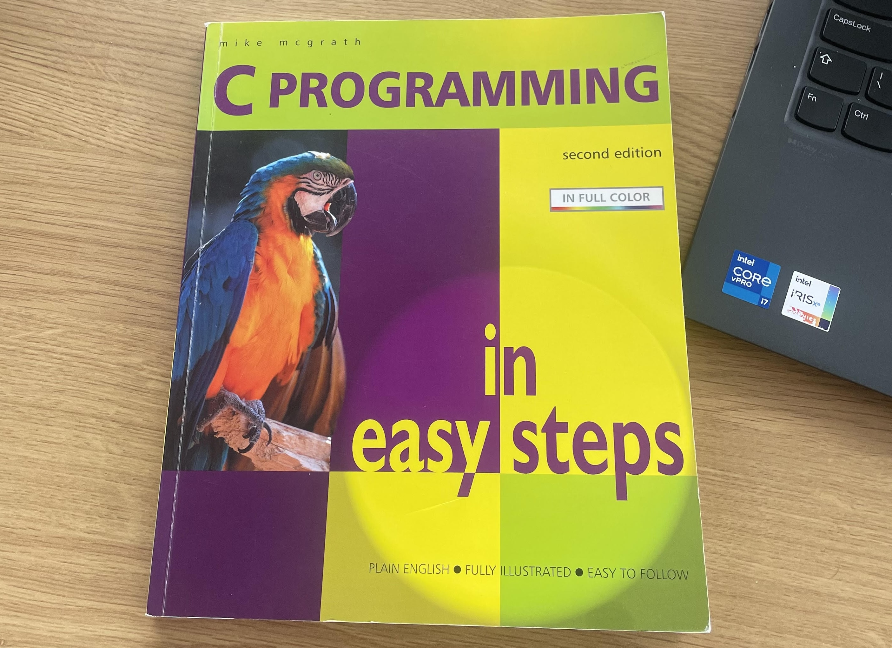
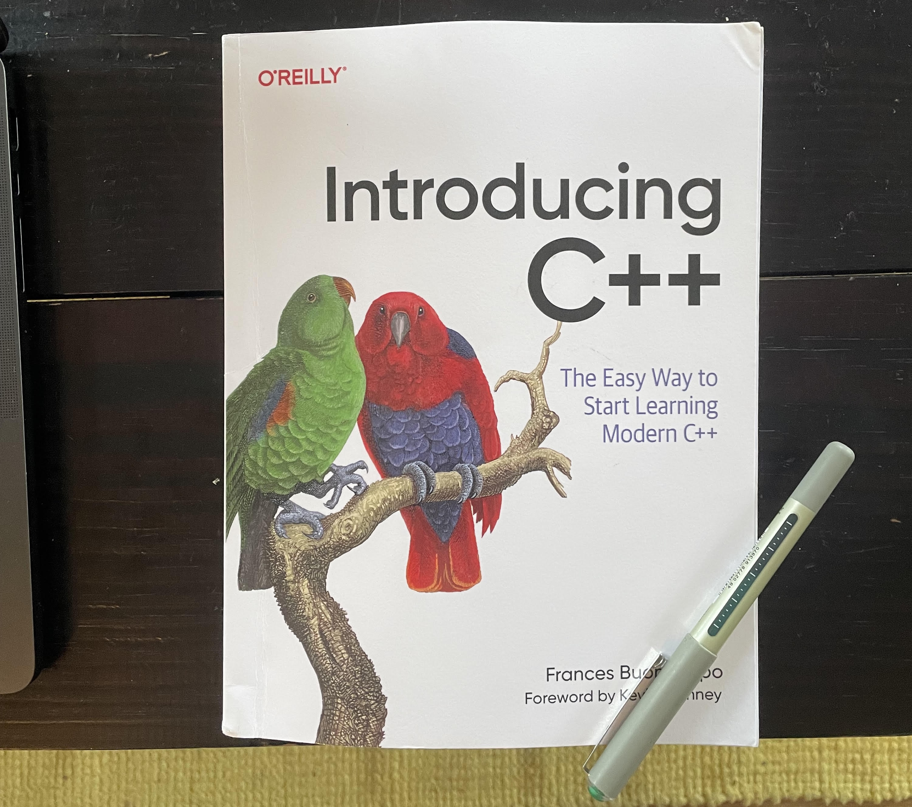

# learning_Cpp

Learning C and C++

## C

Working through an old and short book on C I found (C programming by Mike Mcgrath, 2006)  
The main plan is just to get for this lower level programming vs my background in R/Python before moving onto and focusing on C++.  

- Only used in June 2026

## C++

Also working through a new C++ book (Introducing C++ by Frances Buontempo, 2026)

- Started: June 2026  
- Finished:  

## Next C++ books to consider in order   

- 2nd book: [Discovering Modern C++](https://www.oreilly.com/library/view/discovering-modern-c/9780136798477/) by Peter Gottschling  
- 3rd book: [Effective Modern C++](https://www.oreilly.com/library/view/effective-modern-c/9781491908419/) by Scott Meyers  
- 4th book (a): [Real Time C++](https://link.springer.com/book/9783662742990) 
- - for embedded stuff  
- 4th book (b): [C++ High performance](https://www.oreilly.com/library/view/c-high-performance/9781839216541/)  
- - for speed critical stuff
 
  - 
