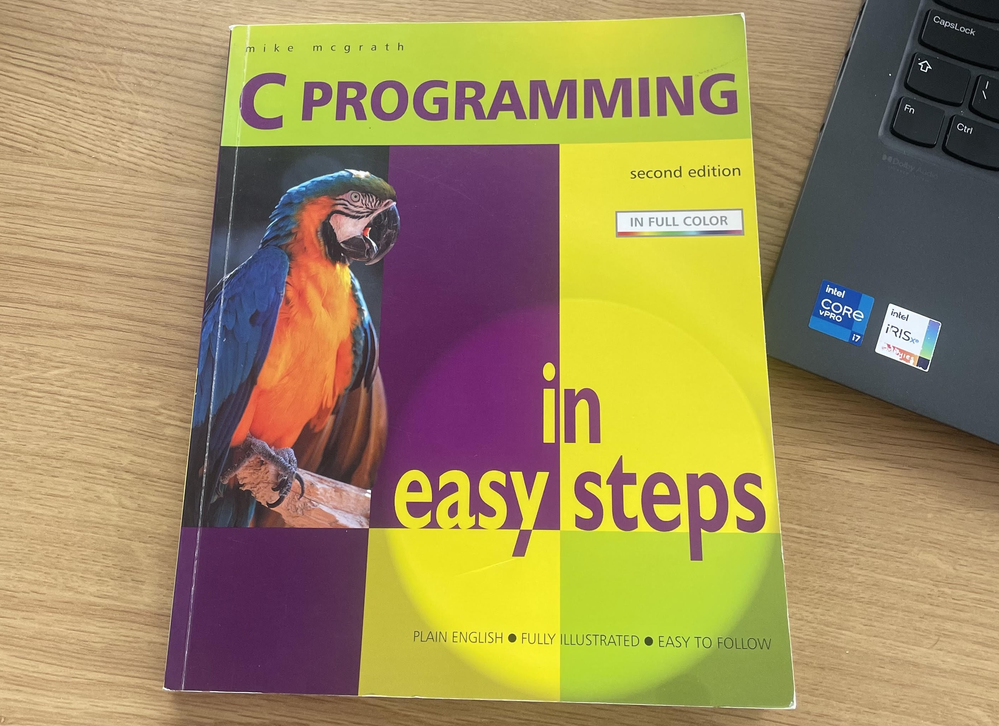
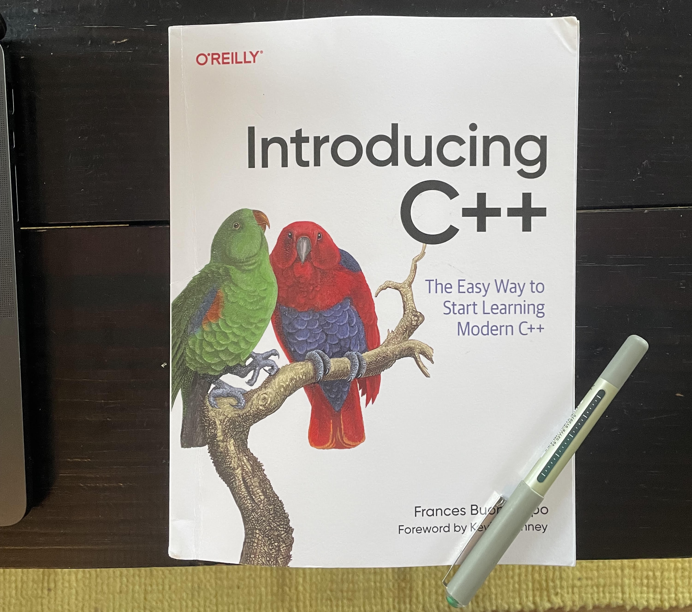

# learning_C++

Learning C and C++

## C

Working through an old and short book on C I found (C programming by Mike Mcgrath, 2006)  
The main plan is just to get for this lower level programming vs my background in R/Python before moving onto and focusing on C++.  

- Only used in June 2026

## C++

Now working through a new C++ book (Introducing C++ by Frances Buontempo, 2026)

- Started: June 2026  
- Finished:  

## Next books to consider in order   

- 2nd book: [Discovering Modern C++](https://www.oreilly.com/library/view/discovering-modern-c/9780136798477/) by Peter Gottschling  
- 3rd book: [Effective Modern C++](https://www.oreilly.com/library/view/effective-modern-c/9781491908419/) by Scott Meyers  
- 4th book: [Real Time C++](https://link.springer.com/book/9783662742990) 
- - for embedded stuff  

## Some extra C++ libraries and projects beyond the books  

#### Pybind  

- Python bindings with `pybind11`

Learning about implementing C++ code into Python scripts with pybind which could be useful for offloading computationally demanding aspects of Python scripts to C++ functions.  

Used in `seeVol` project for main algorithms e.g Amanatides & Woo ray tracing  

#### SFML

#### Using CMake  

